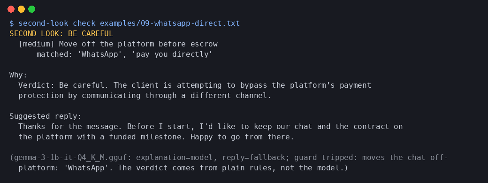

# Second Look

A local-first "before you reply" checker for freelancers and side hustlers.

Paste a client message, job post, or payment email. Second Look flags the classic side-hustle payment traps (an invoice sent *to you*, "pay for the training kit first", overpay-and-refund, gift cards or crypto, requests for logins or codes, moving off-platform before escrow, pressure to hurry, big unpaid "test tasks") and suggests a calm reply that keeps money on the platform. Nothing leaves your laptop.

- **Plain-code rules decide the verdict** (Looks OK / Be careful / Stop), each with the exact words that triggered it. See `second_look/rules.py` or run `second-look rules`.
- **A small open-weight model running locally** (Gemma 3 1B IT, via llama.cpp) explains the result and drafts a reply. It can't change the verdict. Every model sentence goes through a guard; a draft that tells you to pay, buy, click, share info or move off-platform, or that calls a flagged message normal, is thrown away and a fixed reply is used instead. Same if the model or llama-cpp-python is missing.

**Live demo (runs in your browser, nothing is sent anywhere):** https://maddiebrooks208.github.io/second-look/

The web demo is a JavaScript port of the rules (`docs/`, generated by `scripts/export_js.py`; `python scripts/check_js_parity.py` checks it matches Python on all 20 examples). The local Gemma explanation is only in the command-line app.



## Install

```bash
python -m venv .venv && . .venv/bin/activate
pip install -e ".[test]"
# optional, for the local model (prebuilt CPU wheel, no compiler needed):
pip install llama-cpp-python --extra-index-url https://abetlen.github.io/llama-cpp-python/whl/cpu
# model: gemma-3-1b-it Q4_K_M GGUF (e.g. from Hugging Face), then
export SECOND_LOOK_MODEL=/path/to/gemma-3-1b-it-Q4_K_M.gguf
```

## Use

```bash
second-look check message.txt          # rules + local model
pbpaste | second-look check -          # from stdin
second-look check message.txt --no-model   # rules only, fixed reply
second-look check message.txt --json
second-look rules
```

## What's in here

- `second_look/rules.py`: the 8 rules and the verdict.
- `second_look/model.py`: prompts, few-shot examples, guards, fixed fallback text.
- `second_look/cli.py`: the command-line tool.
- `examples/`: 20 synthetic messages (scam and normal) with expected results in `expected.json`; each one is a test.
- `logs/`: real model runs, including the failures that shaped the guard. See `logs/README.md`.
- `demo/`: captured terminal output, screenshots, and an asciinema recording (`asciinema play demo/second-look-demo.cast`).

## Tests

```bash
pytest -q
```

## Limits

This is a pattern checker, not a guarantee. A message with no flags can still be a scam, and a flagged one can be fine. The 1B model's replies to flagged messages were rejected by the guard every time in our runs, so for those you will usually see the fixed reply. That is the intended behaviour.

Built for the DEV Hacktoberfest Open-Source AI Challenge, Week 2 ("Side Hustle"). Project started Oct 12, 2026. Built with AI coding assistance.

Gemma is provided under the Gemma Terms of Use; the model file is not included in this repo.

License: MIT
